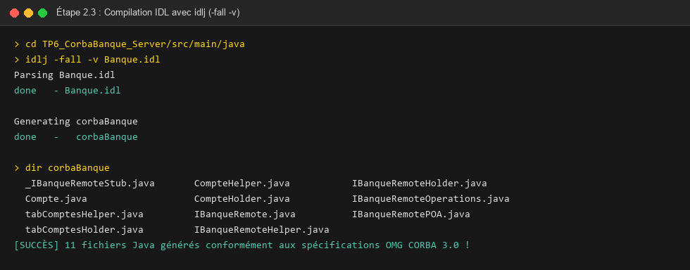
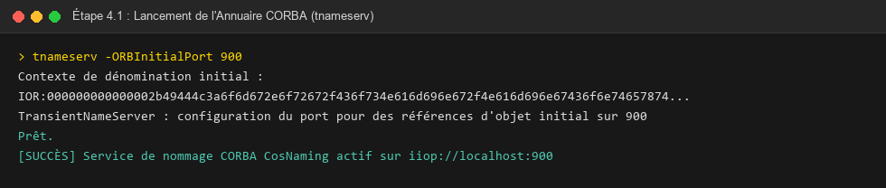
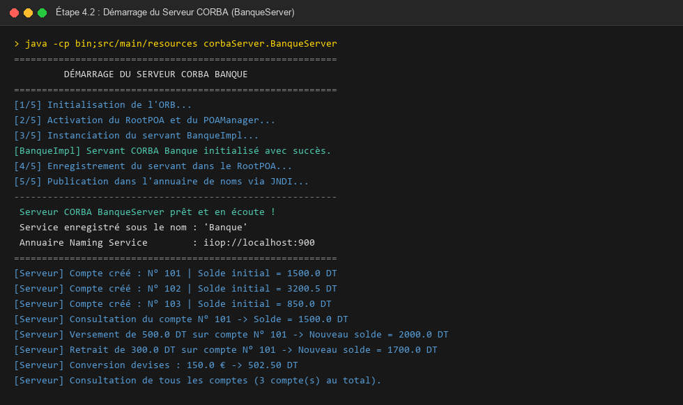
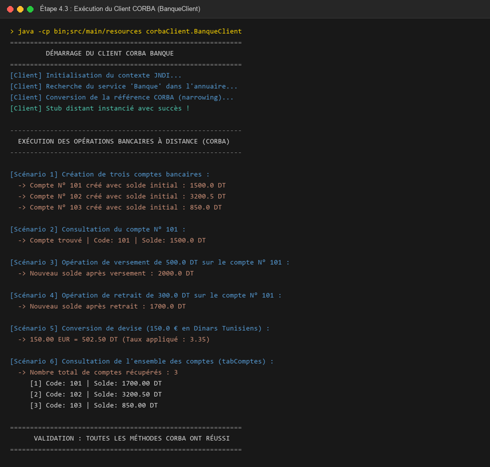

# TP 6 : Service Banque en CORBA

**Faculté des Sciences de Sfax (FSS)**  
**Département d'Informatique et des Communications**  
**Matière :** Développement d'Applications Réparties (LSI 3)  
**Année Universitaire :** 2026 – 2027  
**Responsable du cours :** Mme Amal ABID  
**Enseignante des TPs :** Mme Zeineb DAOUD  
**Étudiant :** Salmen Zekri  
**Dépôt GitHub :** [SalmenZekri_LSI3_DevAppReparties-tp6](https://github.com/zikosalmen/SalmenZekri_LSI3_DevAppReparties-tp6)

---

## 1. Introduction et Objectifs

L'objectif de ce TP est la mise en œuvre d'une application distribuée Client-Serveur en utilisant le middleware standardisé **CORBA** (*Common Object Request Broker Architecture*) avec le langage **Java (JDK 1.8)**.

L'application permet la gestion distante de comptes bancaires à travers les opérations suivantes :
- **Création de compte** avec un solde initial (`creerCompte`).
- **Versement** d'une somme d'argent sur un compte (`verser`).
- **Retrait** d'une somme d'argent avec contrôle du solde (`retirer`).
- **Consultation** des détails d'un compte donné (`getCompte`).
- **Consultation de l'ensemble des comptes** (`getComptes`).
- **Conversion de devises** Euro (€) vers Dinar Tunisien (DT) (`conversion`).

---

## 2. Spécification de l'Interface IDL

Le contrat d'interface est défini dans le fichier `Banque.idl` :

```idl
module corbaBanque {

    struct Compte {
        long code;
        float solde;
    };

    typedef sequence<Compte> tabComptes;

    interface IBanqueRemote {
        void creerCompte(in Compte cpte);
        void verser(in float mt, in long code);
        void retirer(in float mt, in long code);
        Compte getCompte(in long code);
        tabComptes getComptes();
        double conversion(in float mt);
    };
};
```

La compilation s'effectue avec l'outil du JDK 1.8 `idlj` :
```bash
idlj -fall -v Banque.idl
```
Cette commande génère dans le package `corbaBanque` :
- Le stub client : `_IBanqueRemoteStub.java`
- Le squelette d'adaptation serveur (POA) : `IBanqueRemotePOA.java`
- Les structures et helpers associés : `Compte.java`, `CompteHelper.java`, `tabComptesHelper.java`, etc.

---

## 3. Implémentation du Système

### 3.1. Côté Serveur (`TP6_CorbaBanque_Server`)

1. **Le Servant (`service.BanqueImpl`) :**
   - Hérite de `IBanqueRemotePOA`.
   - Implémente la logique de gestion des comptes en mémoire.
   - Gère les contrôles de validité avec les exceptions CORBA appropriées (`BAD_PARAM` et `OBJECT_NOT_EXIST`).
   - Applique le taux de change fixe : 1 € = 3.35 DT.

2. **Configuration JNDI (`jndi.properties`) :**
   ```properties
   java.naming.factory.initial = com.sun.jndi.cosnaming.CNCtxFactory
   java.naming.provider.url = iiop://localhost:900
   ```

3. **Le Serveur Principal (`corbaServer.BanqueServer`) :**
   - Initialise l'ORB : `ORB.init(args, null)`.
   - Active le gestionnaire de POA (`RootPOA`).
   - Instancie le servant `BanqueImpl` et obtient sa référence CORBA.
   - Enregistre la référence dans l'annuaire CosNaming via JNDI sous le nom `"Banque"`.
   - Met l'ORB en attente de requêtes : `orb.run()`.

### 3.2. Côté Client (`TP6_CorbaBanque_Client`)

La classe `corbaClient.BanqueClient` réalise :
- L'initialisation du contexte de nommage JNDI.
- La recherche (*lookup*) de l'objet `"Banque"`.
- La conversion de la référence CORBA (*narrowing*) vers l'interface `IBanqueRemote`.
- L'appel distant successif de toutes les méthodes pour valider les scénarios nominaux.

---

## 4. Résultats Expérimentaux et Captures d'Écran

### 4.1. Compilation IDL avec `idlj`
Compilation du fichier `Banque.idl` générant l'ensemble des stubs et squelettes POA :



---

### 4.2. Démarrage de l'Annuaire CORBA (`tnameserv`)
Lancement du service de nommage sur le port 900 :



---

### 4.3. Démarrage du Serveur (`BanqueServer`)
Activation du RootPOA, instanciation du servant et publication sous le nom `"Banque"` :



---

### 4.4. Exécution du Client (`BanqueClient`)
Validation de toutes les opérations distantes (création, consultation, versement, retrait, conversion et liste) :



---

## 5. Guide d'Exécution Rapide

Sous Windows, l'exécution se fait simplement via les scripts fournis :

1. **Compilation globale (JDK 1.8) :**
   ```cmd
   build_all.bat
   ```

2. **Étape 1 — Démarrer l'annuaire de noms (laisser la fenêtre ouverte) :**
   ```cmd
   1_start_nameservice.bat
   ```

3. **Étape 2 — Démarrer le serveur :**
   ```cmd
   2_start_server.bat
   ```

4. **Étape 3 — Lancer le client :**
   ```cmd
   3_start_client.bat
   ```

---

## 6. Conclusion Académique

Ce travail pratique a permis d'illustrer les forces de l'architecture **CORBA** :
- **Indépendance vis-à-vis du langage** grâce au contrat strict en langage **IDL**.
- **Transparence de localisation** assurée par le bus logiciel **ORB** et le protocole **IIOP**.
- **Interopérabilité** facilitée par le couplage avec l'annuaire standard **CosNaming / JNDI**.
