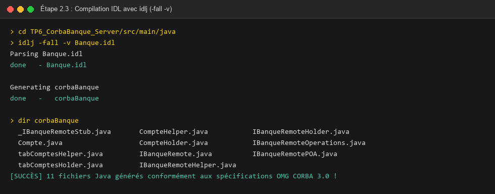
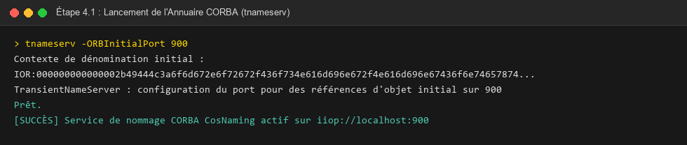
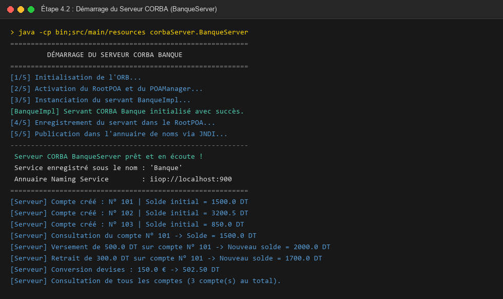
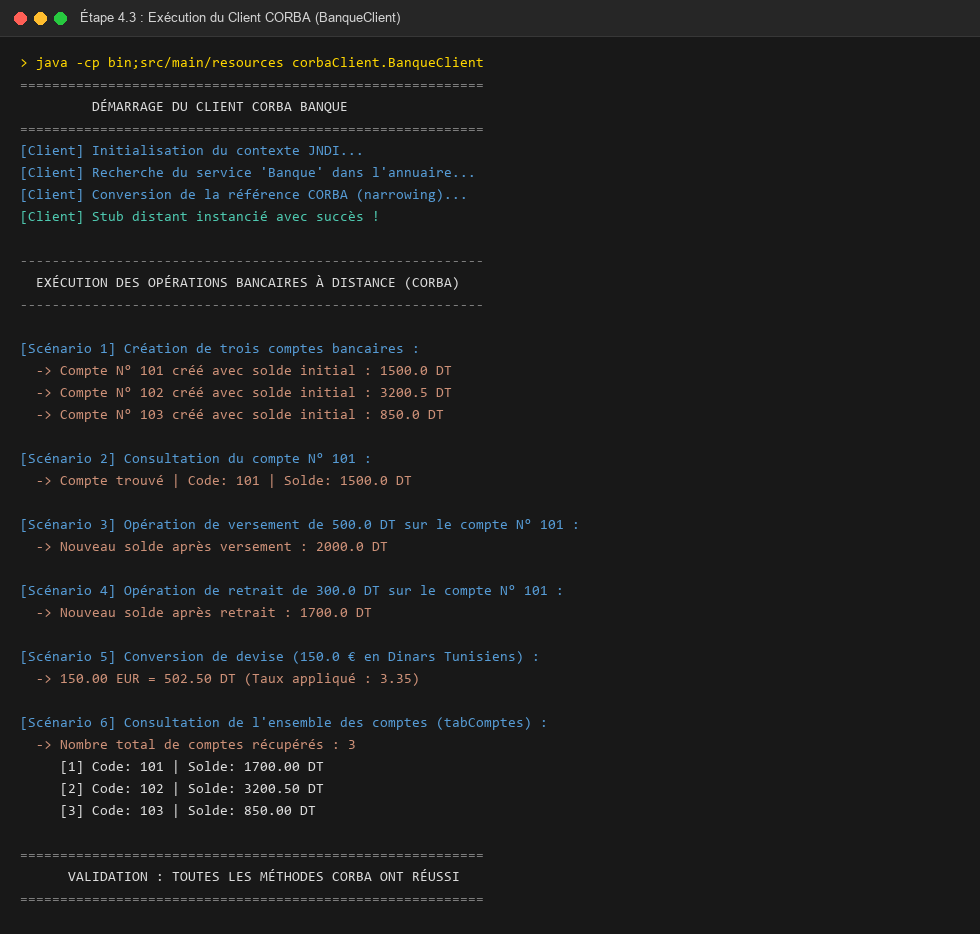

# Compte Rendu — TP 6 : Service Banque en Architecture CORBA

**Faculté des Sciences de Sfax (FSS)** — Département d'Informatique et des Communications  
**Matière :** Développement d'Applications Réparties (LSI 3)  
**Année Universitaire :** 2026 – 2027  
**Responsable du cours :** Mme Amal ABID  
**Enseignante des TPs :** Mme Zeineb DAOUD  
**Étudiant :** Salmen Zekri  
**Dépôt GitHub :** [https://github.com/zikosalmen/SalmenZekri_LSI3_DevAppReparties](https://github.com/zikosalmen/SalmenZekri_LSI3_DevAppReparties)

---

## 1. Objectifs du Travail Pratique

L'objectif de ce TP est la mise en œuvre complète d'une application distribuée orientée objet Client-Serveur en utilisant le middleware standardisé **CORBA** (*Common Object Request Broker Architecture*) et le langage **Java (JDK 1.8)**.

L'application concrétise un **Service Bancaire Distant** où un serveur centralisé gère un ensemble de comptes bancaires (identifiés par `code` et `solde`) et offre aux clients distants les fonctionnalités suivantes :
- Création d'un compte avec un solde initial (`creerCompte`).
- Dépôt / versement d'une somme d'argent sur un compte (`verser`).
- Retrait d'une somme d'argent avec vérification de solde (`retirer`).
- Consultation individuelle d'un compte (`getCompte`).
- Consultation de la liste globale de tous les comptes (`getComptes`).
- Conversion monétaire Euro (€) vers Dinar Tunisien (DT) (`conversion`).

---

## 2. Synthèse Théorique de l'Architecture CORBA

### 2.1. Principes Fondamentaux de CORBA
CORBA est une norme industrielle définie par l'**OMG** (*Object Management Group*) reposant sur le modèle **Broker (Courtier)** :
1. **Indépendance de langage et de plateforme :** Les contrats d'interface sont définis dans un langage neutre universel appelé **IDL** (*Interface Definition Language*).
2. **ORB (Object Request Broker) :** Bus logiciel assurant le routage transparent des requêtes, la localisation des objets distants et le transport des messages réseau via le protocole standardisé **IIOP** (*Internet Inter-ORB Protocol*).
3. **Stubs & Skeletons (POA) :**
   - **Stub (Côté Client) :** Représentant local de l'objet distant. Il sérialise les paramètres (*marshalling*).
   - **POA (Portable Object Adapter / Skeleton côté Serveur) :** Réceptionne la trame IIOP, désérialise les paramètres (*unmarshalling*) et dispatche l'appel vers l'implémentation concrète (*Servant*).
4. **Service de Nommage (CosNaming / JNDI) :** Annuaire distribué permettant d'enregistrer (*bind*) et de retrouver (*lookup*) les références d'objets distants au format IOR (*Interoperable Object Reference*).

```
+------------------------+                             +------------------------+
|      CLIENT JAVA       |                             |      SERVEUR JAVA      |
|      BanqueClient      |                             |      BanqueServer      |
|           |            |                             |           ^            |
|           v            |                             |           |            |
|  Stub (_IBanqueRemote) |                             |  Servant (BanqueImpl)  |
+-----------|------------+                             +-----------^------------+
            | (Marshalling)                                        | (Dispatch)
            v                                                      |
+------------------------+                             +------------------------+
|     Client ORB         |                             | POA (RootPOA Adapter)  |
+-----------|------------+                             +-----------^------------+
            | (IIOP)                                               | (IIOP)
            +===================[ Réseau IIOP / TCP ]==============+
                                         ^
                                         |
                            +--------------------------+
                            |  CosNaming (tnameserv)   |
                            |  Port: 900 (IIOP)        |
                            +--------------------------+
```

---

## 3. Réalisation des Étapes du TP

### Étape 1 : Préparation de l'Espace de Travail
- Création du répertoire de travail : `SalmenZekri_LSI3_DevAppReparties`.
- Configuration de l'environnement d'exécution avec **JDK 1.8** (`Adoptium JDK 8.0.512.9-hotspot`) intégrant nativement la pile CORBA (`org.omg.CORBA.*`, `idlj.exe`, `tnameserv.exe`).

---

### Étape 2 : Développement du Serveur (`TP6_CorbaBanque_Server`)

#### 1. Spécification de l'interface IDL (`Banque.idl`)
Définition contractuelle dans le fichier `src/main/java/Banque.idl` :
```idl
module corbaBanque {
    struct Compte {
        long code;
        float solde;
    };

    typedef sequence<Compte> tabComptes;

    interface IBanqueRemote {
        void creerCompte(in Compte cpte);
        void verser(in float mt, in long code);
        void retirer(in float mt, in long code);
        Compte getCompte(in long code);
        tabComptes getComptes();
        double conversion(in float mt);
    };
};
```

#### 2. Compilation de l'IDL avec l'outil `idlj`
Exécution de la commande :
```bash
idlj -fall -v Banque.idl
```
L'option `-fall` génère à la fois les artefacts clients (Stubs) et serveurs (Skeletons POA) dans le package `corbaBanque` :
- `Compte.java`, `CompteHelper.java`, `CompteHolder.java` (structure de données).
- `tabComptesHelper.java`, `tabComptesHolder.java` (séquence/tableau dynamique).
- `IBanqueRemote.java`, `IBanqueRemoteOperations.java` (interfaces Java).
- `IBanqueRemotePOA.java` (squelette d'adaptation POA côté serveur).
- `_IBanqueRemoteStub.java` (proxy client).



#### 3. Implémentation du Servant Métier (`BanqueImpl.java`)
Dans le package `service`, la classe `BanqueImpl` hérite du squelette `IBanqueRemotePOA` et implémente concrètement le traitement métier avec gestion de la concurrence et contrôle des erreurs (exceptions CORBA `BAD_PARAM` et `OBJECT_NOT_EXIST`).

#### 4. Configuration JNDI (`jndi.properties`)
Conformément aux directives du TP (Page 4), configuration du fournisseur CosNaming sur le port 900 :
```properties
java.naming.factory.initial = com.sun.jndi.cosnaming.CNCtxFactory
java.naming.provider.url = iiop://localhost:900
```

#### 5. Serveur d'Annuaire et Déploiement (`BanqueServer.java`)
Dans le package `corbaServer`, `BanqueServer` réalise le cycle de vie serveur :
1. Initialisation de l'ORB : `ORB.init(args, null)`.
2. Activation du POA Manager : `rootPOA.the_POAManager().activate()`.
3. Instanciation du servant : `BanqueImpl banqueServant = new BanqueImpl()`.
4. Obtention de la référence CORBA distante : `rootPOA.servant_to_reference(banqueServant)`.
5. Publication dans l'annuaire via JNDI : `new InitialContext().rebind("Banque", href)`.
6. Attente bloquante des requêtes clientes : `orb.run()`.

---

### Étape 3 : Développement du Client (`TP6_CorbaBanque_Client`)

Le projet client intègre :
1. Les stubs générés par `idlj` à partir du fichier `Banque.idl`.
2. Le fichier `jndi.properties` pointant sur `iiop://localhost:900`.
3. La classe `corbaClient.BanqueClient` réalisant les étapes :
   - Initialisation du contexte JNDI : `Context ctx = new InitialContext()`.
   - Résolution de nom : `Object ref = ctx.lookup("Banque")`.
   - Transtypage CORBA (*narrowing*) : `IBanqueRemote stub = IBanqueRemoteHelper.narrow((org.omg.CORBA.Object) ref)`.
   - Invocations distantes synchrones de l'ensemble des méthodes métiers.

---

## 4. Exécution, Validation et Résultats Expérimentaux

L'exécution s'effectue selon l'ordonnancement strict des composants du middleware :

### 1. Démarrage de l'Annuaire de Noms CORBA (`tnameserv`)
Lancement du démon de nommage sur le port 900 :
```bash
tnameserv -ORBInitialPort 900
```


---

### 2. Démarrage du Serveur CORBA (`BanqueServer`)
Le serveur initialise l'ORB, active le RootPOA, instancie le servant `BanqueImpl` et publie sa référence sous le nom `"Banque"` dans le service de nommage.



---

### 3. Exécution du Client CORBA (`BanqueClient`)
Le client se connecte à l'annuaire JNDI, récupère le Stub distant et valide avec succès l'ensemble des scénarios de test :
- Création des comptes 101, 102 et 103.
- Consultation du solde du compte 101 (1500.0 DT).
- Dépôt de 500.0 DT sur le compte 101 -> solde actualisé à 2000.0 DT.
- Retrait de 300.0 DT sur le compte 101 -> solde actualisé à 1700.0 DT.
- Conversion de devise : 150.00 EUR -> 502.50 DT (taux 3.35).
- Récupération et affichage du tableau de tous les comptes (`tabComptes`).



---

## 5. Synthèse Comparative : CORBA vs Java RMI

| Critère d'Architecture | CORBA (TP 6) | Java RMI (TP 5) |
| :--- | :--- | :--- |
| **Hétérogénéité Langage** | Polyglotte (Java, C++, Python, Ada...) via contrat **IDL** | Homogène (strictement réservé à l'écosystème Java) |
| **Protocole Réseau** | **IIOP** (*Internet Inter-ORB Protocol*) sur TCP/IP | **JRMP** (*Java Remote Method Protocol*) sur TCP/IP |
| **Adaptateur d'Objets** | **POA** (*Portable Object Adapter*) standardisé | Géré implicitement par `UnicastRemoteObject` |
| **Service de Nommage** | **CosNaming** (`tnameserv` / `orbd`) via JNDI/IIOP | **rmiregistry** standard (port 1099) |
| **Format des Références** | **IOR** (*Interoperable Object Reference*) | Stub RMI désérialisé dynamiquement |

---

## 6. Structure de l'Espace de Travail

```
tp6/
│
├── TP6_CorbaBanque_Server/               # Projet Maven / Eclipse Serveur
│   ├── src/main/java/
│   │   ├── Banque.idl                    # Définition IDL standard
│   │   ├── corbaBanque/                  # 11 classes générées par idlj
│   │   ├── corbaServer/
│   │   │   └── BanqueServer.java         # Déploiement serveur & JNDI
│   │   └── service/
│   │       └── BanqueImpl.java           # Servant métier CORBA
│   ├── src/main/resources/
│   │   └── jndi.properties              # Configuration IIOP (localhost:900)
│   ├── pom.xml                           # Configuration Maven (Java 1.8)
│   ├── generate_idl.bat                  # Script de compilation IDL
│   ├── start_nameservice.bat             # Script de démarrage tnameserv
│   └── run_server.bat                    # Script d'exécution serveur
│
├── TP6_CorbaBanque_Client/               # Projet Maven / Eclipse Client
│   ├── src/main/java/
│   │   ├── Banque.idl
│   │   ├── corbaBanque/                  # Stubs générés par idlj
│   │   └── corbaClient/
│   │       └── BanqueClient.java         # Client JNDI & tests unitaires
│   ├── src/main/resources/
│   │   └── jndi.properties
│   └── pom.xml                           # Configuration Maven (Java 1.8)
│
├── captures/                             # Captures d'écran pour le compte rendu
│   ├── etape2_compilation_idl.png
│   ├── etape4_tnameserv.png
│   ├── etape4_serveur_banque.png
│   └── etape4_client_banque.png
│
├── build_all.bat                         # Compilation automatique globale
├── 1_start_nameservice.bat               # Étape 1 : Lancement annuaire
├── 2_start_server.bat                    # Étape 2 : Lancement serveur
├── 3_start_client.bat                    # Étape 3 : Lancement client
└── README.md                             # Le présent compte rendu académique
```

---

## 7. Guide d'Exécution Rapide

1. **Compilation globale :**
   Double-cliquer sur `build_all.bat` pour générer automatiquement l'IDL et compiler tous les projets avec JDK 1.8.
2. **Lancer l'annuaire de noms :**
   Double-cliquer sur `1_start_nameservice.bat` (laisser la fenêtre ouverte).
3. **Lancer le serveur :**
   Double-cliquer sur `2_start_server.bat`.
4. **Lancer le client de test :**
   Double-cliquer sur `3_start_client.bat`.
